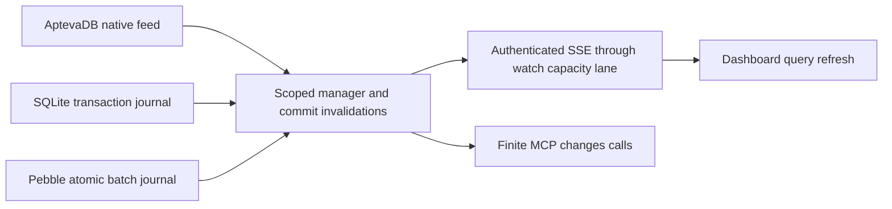

# Real time support for the Database app

Historical design/review notes. See [the current implementation](REALTIME.md) and [release notes](docs/release-0.5.0.md).


Draft, 14 October 2026. Target engine: `github.com/apteva/db v0.2.0-alpha.5`, release commit `2dbc4d428c82e281f1489dd450004a6d33b3adfc`.

Add authenticated, resumable notifications for committed collection changes. Start with AptevaDB's native feed and live dashboard refresh, then implement the same contract for SQLite and Pebble through journals committed alongside data. The first release should deliver **collection invalidations**, so filtered tables, sorted pages and aggregates can refresh correctly. Exact row images and continuously maintained query results belong to subsequent phases.

The current development adapter remains pinned to alpha.4. This proposal introduces no runtime upgrade, data migration or deployed service change.

## Product behavior

A dashboard viewing `orders` should update when another client commits a write, without manual refresh. Reconnecting should replay retained changes or explicitly request a new snapshot. A rolled-back record mutation should not appear as a committed data change.

Agents and sibling apps should be able to ask for changes through a bounded MCP call, using the same project and app-private namespaces as existing tools. Enabling replay capture should be an explicit database management action, since retained history consumes storage and adds write work.

For the dashboard, invalidate and refetch the visible query after a completed commit. Do not patch an ordered page by merely appending arriving rows: inserts, deletions and sort-key changes can change page boundaries. Aggregate widgets should refetch their aggregate rather than infer it from incomplete row information. Preserve unsaved editor content and retain only a dirty flag while editing.

## Native capability and the important boundary

[Alpha.5](https://github.com/apteva/db/releases/tag/v0.2.0-alpha.5) supplies persistent opt-in capture, `Watch`, `SnapshotAndWatch`, retained replay and commit boundaries. Delivery is at least once. Capture settings persist across reopen; disabling/re-enabling or restoring a backup changes feed identity. Format 10 is a one-way upgrade.

A native document filter examines a put's after-image. It does not report a row leaving that predicate, and filtered deletes have no after-image. Therefore `Watch(Filter: status=paid)` cannot maintain a correct local paid-orders list. The first app contract will subscribe by collection, then rerun the user's query. Native maintained computed collections offer a later route to exact membership updates. [Change-feed contract](https://github.com/apteva/db/blob/v0.2.0-alpha.5/CHANGE_FEEDS.md).

## Delivery contract

The initial public payload is a commit invalidation, not an insertion/update audit record:

```json
{
  "type": "invalidate",
  "database": "store",
  "collections": ["orders", "customers"],
  "reason": "records",
  "cursor": "opaque signed app cursor"
}
```

A frame means that the selected collections may have changed at that completed commit. It does not carry private storage keys, record counts, old values or a promise that every put changed a value. Repeated invalidations are safe. Separate reasons cover schema changes, reset and drop. A database drop terminates its stream; recreating the same database name produces a different identity.

Ordering is per database, with one notification per completed commit that affects the subscription. A `db_batch` remains atomic. Physical commits that group several accepted requests can produce one notification containing their union of affected collections. Failed constraints and rollbacks are omitted; an I/O error can have an uncertain outcome, so recovery and persisted commits determine subsequent delivery.

The client saves a cursor only after applying the whole notification. If it checkpoints a cursor before a scheduled refresh completes, it must persist that pending refresh work atomically with the cursor; the dashboard can instead keep cursors in memory and always take a new snapshot after a page reload. A reconnect may replay a notification; consumers must tolerate duplicates. Retention expiry, invalid tokens and restored/replaced history produce an explicit `resnapshot_required` or `resume_invalid` response. No silent fallback to “start now.”

## Backend design

| Backend | Capture and resume mechanism | Rollout |
|---|---|---|
| AptevaDB | Native WAL change feed, wrapped in the app's scope and event format | First release |
| SQLite | Private change journal and head revision in the same SQL transaction as record/schema writes | Next phase |
| Pebble | Private journal/head keys in the same atomic batch as successful writes | Next phase |

For SQLite/Pebble, publish a wake-up only after commit succeeds; the wake-up is an optimization and the persisted journal is authoritative. Publish-on-request-success with an in-memory queue alone would lose changes across a crash. Retention deletion runs in bounded batches outside the main write path. Journals cover app-mediated writes; external manipulation of app-owned files is outside their capture contract.

Pebble's grouped write path needs particular care: collect affected collections from successful callbacks, exclude failed callbacks, and append one journal entry to the final shared batch. Reserve its revision in that same batch. Notify readers only after its durability fence. SQLite reserves its head and journal entry in its existing transaction. Snapshot reads must observe both data and the matching journal head in one read view.

Backend support is a capability, not an assumption added to every existing transaction method. Add an optional `realtimeBackend` with watch, snapshot/watch and status operations, and a manager entry point that resolves authenticated scope. Unsupported backends return an explicit capability error until their journals are implemented; they retain normal CRUD behavior.



## AptevaDB adapter details

Logical collection `orders` maps to native `records_orders`. The native default collection contains our private `schema/<name>` catalog records and `ddl-intent` journal. Never forward a raw database-wide feed to clients.

The trusted adapter should watch the explicitly selected physical collections and, for schema notifications, the native default collection internally. It recognizes only the selected `schema/<name>` keys as schema invalidations, ignores intent/unrelated catalog events and discards all private payloads. Metadata-only capture avoids interpreting catalog JSON as a native document projection. No raw default collection or physical name enters the public API.

Fold events into a bounded set of logical collection names until `EndOfCommit`, then emit an invalidation. A commit with no relevant public change advances a progress cursor without causing a refetch. Account for physical reset/drop during our multi-step DDL protocol and the later catalog publication. UI refetches must use the manager, which serializes them with logical schema publication. Recovered catalog publication must also invalidate observers. Compensated failed DDL may produce conservative reset hints from already committed physical steps; those hints are not an audit claim that a new logical schema was published.

For initial data, resolve the catalog and call native `DB.SnapshotAndWatch` under a short app read lock. Run the initial find/aggregate through an adapter bound to the returned native snapshot; using an ordinary `Manager.Execute` would open a different view. Close the snapshot immediately after those reads, then deliver the queued live changes. Do not retain the manager/database lock while blocking in `Next` or writing to HTTP.

Native cursor buffers are borrowed. Consume/copy metadata before advancing the cursor and use one reader goroutine per cursor. Native errors must map to app errors, including history expiry, disabled capture, watcher limits and reader/capture memory exhaustion. Watch status should report active cursors, replay retention and resource errors.

## API and transport

Add these proposed MCP tools and matching administrative operations:

| Operation | Purpose | Authorization |
|---|---|---|
| `db_realtime_configure` | Enable/disable capture and set retention for one database | `database.manage` |
| `db_realtime_describe` | Report support, enabled state and limits | `database.read` |
| `db_changes` | Return bounded commit invalidations and a resume cursor; optionally wait | `database.read` and new `database.watch` |

`db_changes` accepts logical collection names, an optional cursor, `waitMs` up to 20,000 and a maximum of 100 commit frames / 256 KiB. It returns complete invalidations; it never uses a long-lived MCP tool call. An empty initial cursor can request a current boundary for future notifications, with that choice explicit in the response. Add a changes-specific timeout instead of inheriting the app's two-second write/admin deadline.

For the dashboard, add authenticated `POST /realtime/watch` through the existing platform app proxy. Use `fetch` with same-origin credentials and an SSE response, allowing a structured JSON request and keeping resume tokens out of URLs. Proposed request:

```json
{
  "database": "store",
  "collections": ["orders"],
  "initial": {
    "op": "find",
    "collection": "orders",
    "where": {"field": "status", "op": "eq", "value": "paid"},
    "limit": 50
  },
  "after": ""
}
```

When `initial` is supplied, `after` must be empty. Emit the snapshot result, then `ready` with its boundary cursor, followed by commit invalidations. The browser installs the initial state before accepting that cursor. A resumed watch supplies `after` and omits `initial`. Native snapshot/history expiry during startup requires a new snapshot.

SSE uses `snapshot`, `ready`, `invalidate`, `progress`, `error` and `closed` events. IDs appear only on completed boundary/control frames. Heartbeat comments carry no newer cursor. Track the last delivered boundary; do not expose `cursor.ResumeToken()` if a reader has advanced beyond frames still waiting to be sent. After headers are sent, errors become terminal stream events rather than a new HTTP status.

Initial snapshot results retain the existing 4 MiB result limit; reserve a 5 MiB transport frame for that result and its envelope. Live invalidation/control frames are capped at 64 KiB. No arbitrary row-value frames in phase one.

The React panel should own one connection for its active database/collection, cancel it when the selection/project/install changes, and show live/reconnecting/resynchronizing state. Coalesce refreshes with a 100 ms debounce and a 500 ms maximum wait, so continuous writes cannot postpone refresh forever. Resume with backoff/jitter; after expiry, replace initial state and clear stale pagination cursors. Abort stale fetches and use the existing generation guard.

## Gateway capacity and authorization

The current proxy uses `automaticTransport`; its `admissionBody` releases the permit only when the response body ends. A persistent watch would therefore occupy an ordinary app admission slot for its whole lifetime.

Add a declared streaming route/capacity class through public app-sdk and manifest metadata, and admit `/realtime/watch` and the `db_changes` tool into a separate bounded gateway lane. Finite long polls also occupy connections while waiting, so they must not crowd out CRUD through the normal MCP lane. Classify declared routes/tool identities after authentication rather than trusting a client header. Do not use `NoAuth`, the WebSocket upgrade exception, or an unbounded bypass to escape CRUD limits. Test real streaming through the gateway, not just a direct sidecar URL. The embedded adapter will not inherit the native daemon's separate HTTP watch pool.

Reuse current HTTP administrative caller restrictions: trusted project context, platform bearer exchange, no agent/delegated/app-private callers through the admin route. MCP continues to use `scope(project, caller)` and app-private ownership. Require both read and watch grants there. Streams receive a five-minute authorization lease and reauthenticate on reconnect; gateway logout, membership/permission revocation and uninstall should cancel matching active streams sooner.

Wrap native tokens in a signed app cursor bound to database UUID, authenticated namespace, capture identity and canonical subscription specification. Embed the native token unchanged and let the engine validate its history identity; do not parse its private encoding. Derive a feed-specific signing key from the existing database key, separate from pagination. A native token's integrity check is not authorization. Never accept a client-supplied project/owner override or treat a cursor as a grant.

For an optional later app-event bridge, publish only project-owned database invalidations through SDK `EventBusAPI`. Never publish app-private database names or changes onto a project-wide topic. Persist a publisher checkpoint and use a stable source-commit event ID so retrying publication is idempotent. Event-bus integration is separate from UI streaming.

## Capture lifecycle and limits

Enable capture per database, with administrative management and observable state. Store an explicit policy in the control registry: inherit, enabled or disabled. For native opens, inherit passes nil options; disable passes `Disabled: true`. This prevents ordinary restarts from accidentally ending stored history. Changing policy requires coordinated drain/reopen because native capture options are set at open. Cancel watchers, release snapshots, drain writes and replace the backend handle without changing the database UUID.

Proposed starting limits, to tune against the workloads below:

| Limit | Initial value |
|---|---:|
| Collections per subscription | 16 |
| Active watches per process / database / caller | 64 / 32 / 8 |
| Logical replay retention per enabled database | 128 MiB or 1 hour, whichever expires first |
| Sum of configured logical replay windows per process | 1 GiB |
| Initial snapshot timeout | 30 seconds |
| Heartbeat / write-idle deadline | 15 / 30 seconds |
| Reader working budget | 8 MiB per cursor, 32 MiB native shared budget per database |

Retained WAL includes segment boundaries and recovery tails, so logical retention is not a physical disk cap. Monitor physical disk, native feed accounting, active snapshots and application copies. Keep the native capture-work limit initially at its documented default; benchmark large accepted batches before reducing it, because capture exhaustion can reject a write. Reader exhaustion terminates that watch, while slow-reader expiry triggers a resnapshot. Neither case should silently truncate events or hold writers indefinitely.

Use a bounded reader-to-writer handoff, cancel slow connections on the write-idle deadline and clean up all cursor/snapshot resources on disconnect. Cancel streams before database/app shutdown or drop, without waiting for network writers while holding manager locks.

## Implementation phases and acceptance

1. **Dependency and transport foundation.** Back up native databases with the alpha.4 binary, test migration to format 10 and restore, pin alpha.5, re-audit the codec version guard and run existing correctness/race/performance checks. Add the separate gateway watch lane and real proxy lifecycle tests. An upgrade changes format even when capture is disabled.
2. **AptevaDB first release.** Implement per-database capture policy, scoped invalidation watch, signed cursors, atomic initial snapshot, finite MCP polling and live panel refresh. Expose capabilities only after the tests below pass.
3. **SQLite/Pebble parity.** Add atomic journals, retention, restart replay and snapshot/head boundaries; test grouped Pebble commits and failed callbacks. Run the same public feed contract for all three.
4. **Richer delivery.** Add optional projected after-images with bounded commit framing and historical decoding. Do not fetch current rows to impersonate an older event's value. Introduce computed-collection support before advertising exact filtered membership, and evaluate live aggregates separately. Add an explicitly enabled, scoped event-bus bridge if workflows need it.

Correctness gates include writes arriving during initial reads, partial-disconnect replay, duplicates, history expiry, restart/recovery, rollback/unique conflicts, unknown I/O outcomes, schema/index changes, drop/recreate, restore/new identity, forged/cross-scope tokens, grant revocation and cleanup of idle streams. Verify no private catalog data escapes. Stress slow readers and quota exhaustion while checking that ordinary CRUD remains responsive. Test a row leaving a filtered table and a row moving out of the current sorted page; both must trigger a correct refresh.

Performance runs should compare capture off/on and 0/1/10/64 watchers, plus 100 with raised limits, using metadata invalidations. Measure 100k/1m records, single and 1,000-row writes, filtered-page refresh, grouped aggregates, matching scopes, many databases and slow clients. Preserve full and ordinary-fsync profiles for app/direct comparisons. Record commit-to-notification and commit-to-visible-refresh p50/p95, write overhead, allocations/RSS, retained disk and CRUD latency under stream load. Initial product targets are notification p95 below 100 ms and visible refresh below 500 ms for the representative indexed query, subject to measurement. The release's asynchronous engine benchmarks are not an app throughput forecast.

## Code locations and source references

| Location | Proposed work |
|---|---|
| `engine/database.go`, new feed manager/types | Scope resolution, stream lifecycle, capabilities and signed cursors |
| `engine/aptevadb.go` and schema helpers | Capture policy, native feed translation and snapshot-bound initial queries |
| `engine/sqlite.go`, `engine/pebble.go`, `engine/write_queue.go` | Atomic journals and grouped commit handling in the parity phase |
| `main.go`, `apteva.yaml`, config helpers | New tools/routes, watch grants, management and limits |
| `ui/DatabasePanel.tsx` | Fetch/SSE lifecycle, refresh coalescing and reconnect state |
| Public app-sdk plus server app proxy/admission | Declared stream lane, authorization lease and cancellation |
| Tests and benchmarks | Shared feed contract, real gateway tests, migration and matched-profile performance |

Native sources: [change-feed API](https://github.com/apteva/db/blob/v0.2.0-alpha.5/change_feed.go), [cursor and snapshot boundary](https://github.com/apteva/db/blob/v0.2.0-alpha.5/change_cursor.go).

Implementation references: [scope and HTTP guards](main.go), [database lifetime](engine/database.go), [native DDL publication](engine/aptevadb_schema.go), [panel](ui/DatabasePanel.tsx). Platform references at proposal time were `server/apps_loader.go`, `server/automatic_admission.go` and the public app-sdk event bus API.
